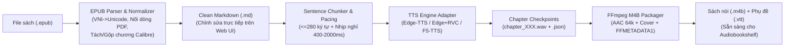

# 🎧 epub2m4b — Vietnamese AI Audiobook Studio (`.epub` $\rightarrow$ `.m4b` + `.vtt`)

**epub2m4b** là bộ công cụ kèm giao diện **Gradio Web UI Studio** chạy local (tối ưu cho WSL2 + GPU **NVIDIA RTX 3060 12GB VRAM**), giúp chuyển đổi sách điện tử `.epub` Tiếng Việt sang sách nói `.m4b` chất lượng cao có nhúng **Ảnh bìa**, **Chapter Timeline (`FFMETADATA1`)** và phụ đề chạy chữ **WebVTT (`.vtt`)** phục vụ máy chủ **Audiobookshelf**.

---

## ✨ Tính năng nổi bật

1. **Bộ đọc & làm sạch EPUB Tiếng Việt thực chiến (`core/epub_parser.py`, `core/text_normalizer.py`):**
   - **Tự động tách đa chương trong 1 file HTML (Calibre Split):** Xử lý triệt để các file `.epub` bị Calibre gộp 10–25 chương vào chung một file `index_split_XXX.html`.
   - **Tự động nối chương bị cắt ngang file (Mid-chapter Split):** Nếu Calibre ngắt file `.html` ở mốc 260KB ngay giữa một chương (file kế tiếp không có tiêu đề chương ở đầu), tự động ghép nối liền mạch vào chương trước.
   - **Tự động sửa lỗi bảng mã `VNI-Windows` & chuẩn hóa `Unicode NFC`:** Giải mã tự động các đoạn/trang tiêu đề dùng font VNI cũ (ví dụ `Ñöùa Treû Hö - Töû Kim Traàn` $\rightarrow$ `Đứa Trẻ Hư - Tử Kim Trần`) mà không làm sai lệch nguyên âm đôi Tiếng Việt (`hoàn toàn`, `toàn trường`).
   - **Hàn gắn câu bị gãy dòng từ PDF (Broken PDF Line-wrap Healer):** Tự động nối các thẻ `<p>` bị ngắt dòng vô lý giữa câu hoặc giữa từ khi convert từ PDF sang EPUB, tránh việc TTS ngắt nghỉ 800ms giữa chừng.
   - **Chuẩn hóa phát âm Tiếng Việt cho TTS:** Đổi số La Mã (`Chương IV` $\rightarrow$ `Chương 4`), ngày tháng (`19/05/1990` $\rightarrow$ `19 tháng 5 năm 1990`, `1/5` $\rightarrow$ `1 tháng 5`), từ viết tắt (`TP.HCM`, `HN`, `NXB`, `TS.`, `GS.`, `PGS.`), và lọc sạch ký tự Markdown/HTML (`*`, `_`, `~`, `[1]`, URL) để TTS không đọc nhầm tên dấu câu.
   - **Tự động bỏ chọn chương rác (Boilerplate Filtering):** Tự động uncheck các trang Mục lục, Bản quyền, Bìa sách hoặc trang thông tin ngắn (`< 40` ký tự).

2. **Đa Engine TTS (Adapter Pattern) + Nhịp nghỉ tự nhiên & Checkpoint (`core/tts_engine.py`):**
   - **Chia câu thông minh (`<= 280` ký tự):** Ưu tiên tách theo dấu kết câu (`. ! ? …`), sau đó theo mệnh đề (`, ; :`), đảm bảo không vượt ngưỡng ngữ cảnh của các model TTS.
   - **Chèn khoảng lặng (Silence Pacing) chuẩn sách nói:**
     - Sau tiêu đề chương (`#`): **`2000ms`**
     - Dấu chuyển cảnh (`---`): **`1500ms`**
     - Sau tiêu đề phụ (`##`): **`1200ms`**
     - Kết thúc đoạn văn: **`800ms`**
     - Giữa các câu trong đoạn: **`400ms`**
   - **3 Chế độ giọng đọc:**
     1. **`EdgeTTSEngine`** (`vi-VN-NamMinhNeural`, `vi-VN-HoaiMyNeural`) — chạy ngay không cần GPU, tốc độ cực nhanh.
     2. **`EdgeTTSEngine` + `RVC v2`** (`rvc-python` trên RTX 3060 12GB với file `.pth` + `.index`) — giữ độ chuẩn phát âm Tiếng Việt của Microsoft Neural nhưng mang màu giọng MC/người đọc yêu thích.
     3. **`F5TTSEngine`** (`f5-tts_infer-cli` trên RTX 3060 12GB) — nhân bản giọng đọc (Zero-shot Voice Cloning) từ 10–15 giây audio mẫu.
   - **Checkpoint từng chương:** Lưu `chapter_XXX.wav` + `chapter_XXX.json` (chứa danh sách `SubtitleCue`). Nếu quá trình render sách dài 80–100 chương bị gián đoạn, bấm chạy lại sẽ tự động bỏ qua các chương đã hoàn tất.

3. **Đóng gói `.M4B` chuẩn Audiobookshelf & Phụ đề `.VTT` (`core/m4b_packager.py`):**
   - Nối toàn bộ chương bằng `ffmpeg -f concat`, mã hóa âm thanh **AAC 64kbps Mono** (`24kHz`, `+faststart`).
   - Nhúng **Chapter Timeline (`FFMETADATA1`)** chính xác tới từng mili-giây (`TIMEBASE=1/1000`).
   - Nhúng ảnh bìa sách (`attached_pic`).
   - Xuất kèm phụ đề chạy chữ **WebVTT (`.vtt`)** cộng dồn thời gian xuyên suốt toàn bộ cuốn sách.

---

## 🏗️ Kiến trúc tổng quan



---

## 📂 Cấu trúc thư mục

```text
epub2m4b/
├── app.py                      # Giao diện Gradio Web UI Studio (3 khu vực)
├── core/
│   ├── models.py               # Data models: Chapter, BookMetadata, AudioSegmentSpec
│   ├── text_normalizer.py      # Làm sạch HTML->MD, VNI->Unicode, chuẩn hóa Tiếng Việt, cắt câu
│   ├── epub_parser.py          # Đọc EPUB, trích ảnh bìa, tách/gộp chương Calibre, lọc mục lục
│   ├── tts_engine.py           # Adapter TTS (Edge, Edge+RVC, F5-TTS), chèn nhịp nghỉ & checkpoint
│   └── m4b_packager.py         # Tạo FFMETADATA1, xuất WebVTT (.vtt), đóng gói FFmpeg (.m4b)
├── tests/                      # Bộ Unit & Smoke Tests (pytest)
│   ├── test_text_normalizer.py
│   ├── test_epub_parser.py
│   ├── test_tts_engine.py
│   ├── test_m4b_packager.py
│   └── test_app_smoke.py
├── docs/
│   ├── ARCHITECTURE.md         # Tài liệu kiến trúc & thuật toán chi tiết
│   └── USER_GUIDE.md           # Hướng dẫn sử dụng Web UI, RVC/F5-TTS & Audiobookshelf
├── workspace/                  # Thư mục tạm chứa sách đang xử lý, cache chương và file .m4b xuất ra
└── pyproject.toml              # Cấu hình dự án và dependencies (uv)
```

---

## 🚀 Cài đặt & Khởi chạy nhanh

### 1. Yêu cầu hệ thống
- Python **3.12+** (quản lý qua [`uv`](https://docs.astral.sh/uv/)).
- `ffmpeg` và `ffprobe` (đã được liên kết sẵn trong `.venv/bin/ffmpeg` và `.venv/bin/ffprobe`).

### 2. Chạy kiểm thử (Unit & Smoke Tests)
```bash
.venv/bin/pytest -v
```

### 3. Khởi động Web UI Studio
- **Chạy bình thường:**
  ```bash
  uv run python app.py
  ```
- **Chạy chế độ Watch (tự động reload khi sửa code `app.py` hoặc `core/`):**
  ```bash
  uv run python app.py --watch
  # hoặc dùng gradio CLI:
  uv run gradio app.py
  ```
Mở trình duyệt tại địa chỉ: **`http://localhost:7860`**

---

## 📖 Tài liệu chi tiết
- [**Kiến trúc hệ thống & Xử lý dữ liệu (`docs/ARCHITECTURE.md`)**](docs/ARCHITECTURE.md)
- [**Hướng dẫn sử dụng Web UI, GPU Voice Cloning & Audiobookshelf (`docs/USER_GUIDE.md`)**](docs/USER_GUIDE.md)
