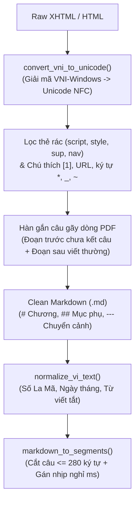

# 🏛️ Tài liệu Kiến trúc & Thuật toán (`epub2m4b`)

Tài liệu này mô tả chi tiết thiết kế mô-đun, cấu trúc dữ liệu và các thuật toán xử lý văn bản/âm thanh bên trong **epub2m4b**.

---

## 1. Mô hình dữ liệu cốt lõi (`core/models.py` & `core/tts_engine.py`)

| Lớp dữ liệu | Định nghĩa tại | Các trường chính | Vai trò |
| :--- | :--- | :--- | :--- |
| `Chapter` | `core/models.py` | `index: int`, `title: str`, `markdown: str`, `enabled: bool` | Đại diện cho 1 chương sách sau khi phân tách từ EPUB hoặc từ kịch bản Clean Markdown. |
| `BookMetadata` | `core/models.py` | `title: str`, `author: str`, `cover_path: Path \| None`, `chapters: list[Chapter]` | Toàn bộ thông tin siêu dữ liệu và danh sách chương của cuốn sách. |
| `AudioSegmentSpec` | `core/models.py` | `text: str`, `pause_after_ms: int`, `is_chapter_title: bool` | Đơn vị câu văn đã chuẩn hóa (`<= 280` ký tự) kèm thời lượng nghỉ sau câu. |
| `SubtitleCue` | `core/tts_engine.py` | `start_ms: int`, `end_ms: int`, `text: str` | Mốc thời gian phụ đề của một câu tính từ đầu chương (`0ms`). |
| `ChapterAudioResult` | `core/tts_engine.py` | `chapter_index: int`, `title: str`, `audio_path: Path`, `duration_ms: int`, `cues: list[SubtitleCue]` | Kết quả tổng hợp âm thanh của 1 chương (lưu cache tại `chapter_XXX.wav` + `chapter_XXX.json`). |

---

## 2. Tầng 1: Phân tích EPUB & Chuẩn hóa Clean Markdown

### 2.1. Giải quyết các cấu trúc EPUB phức tạp (`core/epub_parser.py`)
Trong thực tế, ebook Tiếng Việt (đặc biệt các sách xuất từ **Calibre**, convert từ `.prc`, `.mobi`, `.pdf` hoặc `.docx`) không tuân theo quy chuẩn "1 file HTML = 1 chương". Hàm `parse_epub()` xử lý trọn vẹn 4 trường hợp:

1. **Một file HTML chứa nhiều chương (Multi-chapter Calibre Spine File):**
   - Calibre thường cắt file theo dung lượng (~260KB/file: `index_split_001.html`, `index_split_002.html`...), mỗi file chứa từ 10 đến 25 chương.
   - `clean_html_to_markdown()` phát hiện cấp thẻ tiêu đề chính (`primary_heading_tag` trong `h1, h2, h3`), các thẻ khớp mẫu tên chương (`_CHAPTER_HEADING_RE`) hoặc các đoạn `
` ngắn đóng vai trò tiêu đề chương (`_PARA_CHAPTER_RE`), chuyển tất cả thành `# Tên chương`.
   - Sau đó `parse_epub()` tách toàn bộ các khối `# Tên chương` thành từng đối tượng `Chapter` riêng biệt.

2. **Một chương bị cắt đôi qua 2 file HTML (Mid-chapter Calibre Split):**
   - Khi Calibre ngắt file `.html` ngay giữa một chương, file `.html` tiếp theo sẽ bắt đầu bằng các thẻ `
` mà không có tiêu đề `# ` ở đầu.
   - `parse_epub()` gọi `clean_html_to_markdown(..., allow_leading_orphan=True)`: nếu phát hiện đoạn văn mở đầu file mới chưa có `# ` và chương liền trước đang `enabled=True`, hệ thống tự động nối (`merge`) phần văn bản mồ côi đó vào cuối chương liền trước.

3. **Trang thông tin đầu sách không có tiêu đề:**
   - Nếu một file ở đầu sách không có thẻ tiêu đề và nội dung dưới 40 ký tự (ví dụ chỉ ghi tên sách và tác giả), hệ thống đặt tên là `Trang đầu / Thông tin sách` và tự động đặt `enabled=False` để không chiếm mất số thứ tự `Chương 1`.

4. **Tự động lọc chương rác (`_is_boilerplate_chapter`):**
   - Bỏ chọn (`enabled=False`) nếu tiêu đề chứa từ khóa: `mục lục`, `table of contents`, `bản quyền`, `copyright`, `cover`, `bìa sách`, `thông tin xuất bản` hoặc phần thân chương ngắn hơn `40` ký tự.

---

### 2.2. Khôi phục bảng mã, nối dòng PDF & Chuẩn hóa Tiếng Việt (`core/text_normalizer.py`)

- **Khôi phục font `VNI-Windows` (`convert_vni_to_unicode`):**
  - Chỉ kích hoạt khi chuỗi khớp mẫu đặc trưng VNI (`_VNI_DETECT_RE`: có chứa `Ñ, ñ, ö, Ö, æ, î` hoặc nguyên âm ghép dấu kiểu VNI như `aù, aø, aû, eû, öù, aà...`), tránh tuyệt đối việc chạm vào các nguyên âm đôi hợp lệ trong Unicode Tiếng Việt (`oà, oá` trong `hoàn toàn`, `toán học`).
- **Hàn gắn câu bị gãy dòng từ PDF (Broken PDF Line-wrap Healer):**
  - Khi hai đoạn văn liên tiếp mà đoạn trước **không kết thúc** bằng dấu câu (`. ! ? … : ; " ” ' ) ] »`) và đoạn sau **bắt đầu bằng chữ cái Tiếng Việt viết thường** (`a-z`, `àáảãạ...`), hai đoạn sẽ được nối lại bằng khoảng trắng thay vì tách thành 2 đoạn `\n\n`.
- **Chuẩn hóa văn bản trước khi đọc (`normalize_vi_text`):**
  - `Chương IV` / `Phần IX` $\rightarrow$ `Chương 4` / `Phần 9` (hỗ trợ `I` $\rightarrow$ `XX`).
  - `19/05/1990` hoặc `19-05-1990` $\rightarrow$ `19 tháng 5 năm 1990`.
  - `1/5` $\rightarrow$ `1 tháng 5` (chỉ đổi khi ngày $\le 31$ và tháng $\le 12$).
  - Từ viết tắt: `TP.HCM` $\rightarrow$ `Thành phố Hồ Chí Minh`, `HN` $\rightarrow$ `Hà Nội`, `NXB` $\rightarrow$ `Nhà xuất bản`, `TS.` $\rightarrow$ `Tiến sĩ`, `GS.` $\rightarrow$ `Giáo sư`, `PGS.` $\rightarrow$ `Phó giáo sư`.

---

## 3. Tầng 2: Đa Engine TTS, Nhịp nghỉ & Checkpoint (`core/tts_engine.py`)

### 3.1. Bảng quy tắc nhịp nghỉ (Silence Pacing)
Hàm `markdown_to_segments()` biến đổi Clean Markdown thành danh sách `AudioSegmentSpec`:

| Thành phần trong Markdown | Cú pháp | Khoảng nghỉ chèn sau câu (`pause_after_ms`) |
| :--- | :--- | :---: |
| Tiêu đề chương | `# Tên chương` | **`2000 ms`** |
| Chuyển cảnh (Scene break) | `---` hoặc `***` | **`1500 ms`** (nâng nhịp nghỉ của câu liền trước) |
| Tiêu đề phụ | `## Tiêu đề phụ` | **`1200 ms`** |
| Câu cuối của một đoạn văn | Đoạn cách nhau bởi dòng trống | **`800 ms`** |
| Câu giữa đoạn / mệnh đề cắt nhỏ | `. ! ? …` hoặc `, ; :` | **`400 ms`** |

### 3.2. Cơ chế ghép WAV & Checkpoint (`render_chapter`)
- Tất cả các đoạn âm thanh do TTS sinh ra đều được chuẩn hóa về định dạng đồng nhất qua `ffmpeg`: **WAV PCM 16-bit (`s16`), Mono (`-ac 1`), tần số lấy mẫu `24000 Hz`**.
- Khoảng nghỉ giữa các câu được ghi trực tiếp bằng các frame mẫu `0` (`b'\x00\x00' * silence_frames`) vào luồng WAV của chương — đảm bảo thời gian khớp tuyệt đối 100% với mốc `start_ms` / `end_ms` của `SubtitleCue`.
- Khi hoàn tất 1 chương, `render_chapter()` lưu 2 file vào `workspace/<ten_sach>/chapters_audio/`:
  - `chapter_XXX.wav`: File âm thanh hoàn chỉnh của chương.
  - `chapter_XXX.json`: Chứa `title`, `duration_ms`, và mảng `cues`.
- Nếu gọi lại `render_chapter(..., force=False)` khi cả 2 file đã tồn tại, hàm đọc thẳng từ JSON mà không cần gọi lại TTS.

---

## 4. Tầng 3: Đóng gói `.M4B` & Phụ đề `.VTT` (`core/m4b_packager.py`)

1. **Sinh `FFMETADATA1` (`build_ffmetadata`):**
   - Tính toán `START` và `END` cộng dồn theo mili-giây (`TIMEBASE=1/1000`) cho từng chương.
   - Tự động escape các ký tự đặc biệt (`=`, `;`, `#`, `\`, xuống dòng) trong tên sách, tác giả và tên chương.
2. **Sinh phụ đề `WebVTT` (`export_webvtt`):**
   - Duyệt qua từng chương, cộng dồn `offset_ms` của các chương trước vào `cue.start_ms` và `cue.end_ms` để xuất ra file `.vtt` khớp từ đầu đến cuối sách.
3. **Đóng gói `.M4B` (`package_m4b`):**
   - Dùng `ffmpeg -f concat -safe 0` ghép nối các file `chapter_XXX.wav`.
   - Ánh xạ siêu dữ liệu và danh sách chương (`-map_metadata 1 -map_chapters 1`).
   - Nếu có ảnh bìa (`meta.cover_path`), nhúng luồng video ảnh bìa với cờ `-disposition:v:0 attached_pic`.
   - Nén âm thanh sang **AAC 64kbps Mono** (`-c:a aac -b:a 64k -ac 1 -movflags +faststart`) giúp file nhẹ, tương thích mọi thiết bị phát và tua nhanh tức thì trên **Audiobookshelf**.
