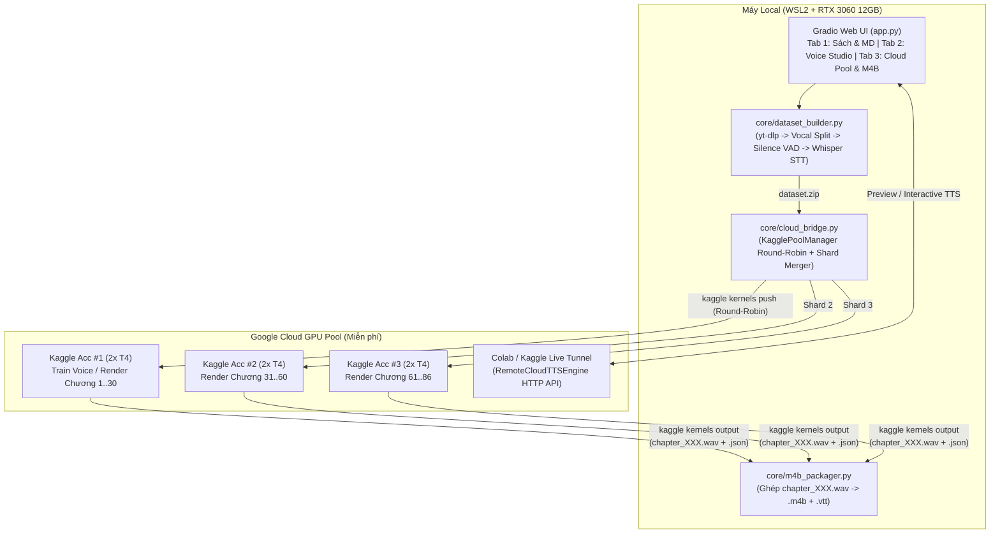

# Thiết kế Hệ thống: Local Data Prep + Cloud GPU Voice Cloning & Multi-Account Kaggle Dispatcher (`epub2m4b` Phase 2)

- **Ngày:** 2026-10-27
- **Trạng thái:** Draft (Chờ duyệt trước khi lập Implementation Plan)
- **Mô hình thực thi:** Coordinator (Antigravity Architect/Reviewer) $\leftrightarrow$ Coding Agent (`opencode run --auto -m omniroute/deepseek-v4-flash`)

---

## 1. Mục đích & Động lực (Intent & Why)
Mục tiêu của giai đoạn 2 là nâng cấp **epub2m4b** từ một công cụ đọc sách nói cơ bản thành một **AI Voice Cloning & Cloud-First Audiobook Studio** phục vụ nhu cầu cá nhân:
1. Cho phép lấy giọng của bất kỳ người đọc truyện/MC/podcaster nào (từ YouTube hoặc file audio/video có sẵn) để đọc tiểu thuyết dài tập một cách **có hồn, có hơi thở, không bị "công nghiệp" như giọng TikTok/CapCut**.
2. Tận dụng **máy Local (RTX 3060 12GB VRAM + WSL2)** cho các tác vụ nhẹ/tương tác nhanh (cào audio từ YouTube, tách nhạc nền, cắt câu ngắn, biên tập kịch bản Clean Markdown `.md`, và ghép `.m4b` cuối cùng).
3. Tận dụng **Cloud GPU miễn phí của Google (Kaggle `2x T4 30GB` với cơ chế xoay vòng nhiều tài khoản Round-Robin + Google Colab Remote API)** để gánh toàn bộ phần nặng nhất: **Fine-tune model giọng đọc (`GPT-SoVITS` / `RVC v2` / `Vi-F5-TTS`)** và **cày (render) hàng chục chương sách song song** mà không làm nóng/ồn máy tính cá nhân.

---

## 2. Goals, Non-Goals & Anti-Goals

### Goals (Mục tiêu cần đạt)
1. **Local Dataset Builder (`core/dataset_builder.py`):**
   - Tải audio từ URL YouTube (hoặc nhận file `.mp3`/`.wav`/`.mp4` local) qua `yt-dlp`.
   - Khử nhạc nền/tạp âm để giữ lại giọng nói sạch (Vocal Isolation) và chuẩn hóa âm lượng (`-ac 1 -ar 24000` hoặc `32000`).
   - Tự động cắt nhỏ thành các đoạn 4–12 giây theo khoảng lặng (`silero-vad` / `ffmpeg silencedetect`) và tự động tạo transcript Tiếng Việt bằng `faster-whisper` (chạy trên RTX 3060 hoặc đẩy lên Cloud), đóng gói thành chuẩn `dataset.zip` (`wavs/` + `metadata.csv`).
2. **Cloud GPU Bridge & Multi-Account Kaggle Round-Robin (`core/cloud_bridge.py`):**
   - **Không cần cài MCP ngoài:** Sử dụng trực tiếp REST API / CLI chính thức của Kaggle (`kaggle` package) ngay trong Python.
   - Quản lý danh sách nhiều tài khoản Kaggle (`kaggle_accounts.json`: `username`, `api_key`, `weekly_quota_used_sec`) theo cơ chế **Round-Robin** và **Sharded Batch**:
     - Tự động chọn tài khoản tiếp theo khi đẩy job Fine-tune hoặc Render.
     - Hỗ trợ **chia nhỏ cuốn sách 80–100 chương thành $N$ phần (shards)** đẩy lên $N$ tài khoản Kaggle chạy **song song cùng lúc** (mỗi tài khoản dùng `2x T4` chạy 2 luồng GPU 0 & GPU 1 = nhân 4, nhân 6 tốc độ render!).
   - Hỗ trợ **Remote API Worker (`RemoteCloudTTSEngine` trong `core/tts_engine.py`)**: Kết nối tới URL công khai (`gradio.live` / `trycloudflare.com`) chạy trên Google Colab hoặc Kaggle để nghe thử (`Preview`) và render trực tiếp từ Web UI local.
3. **Cloud Worker Scripts & Notebooks (`cloud/`):**
   - `cloud/kaggle_train_voice.py`: Script chạy trên Kaggle `2x T4` nhận `dataset.zip`, thực hiện Fine-tune giọng (`RVC v2` hoặc `GPT-SoVITS` / `Vi-F5-TTS` checkpoint) và xuất ra `voice_pack.zip`.
   - `cloud/kaggle_render_shard.py`: Script chạy trên Kaggle `2x T4` nhận một tập chương (`chapters_shard.json` + `voice_pack`), chia GPU 0 (chương lẻ) và GPU 1 (chương chẵn) render ra các file `chapter_XXX.wav` + `chapter_XXX.json` chuẩn checkpoint của `epub2m4b`.
   - `cloud/colab_remote_worker.ipynb`: Notebook 1-click trên Google Colab/Kaggle bật FastAPI/Gradio endpoint cho chế độ `RemoteCloudTTSEngine`.
4. **Mở rộng Giao diện Gradio Web UI (`app.py`):**
   - Bổ sung Tab **"🎙️ 2. Cào Data & Tuning Giọng (Voice Studio)"** và tích hợp **"☁️ Cloud GPU Pool (Kaggle Multi-Account / Colab API)"** vào luồng tạo sách `.m4b`.

### Non-Goals (Không nằm trong phạm vi)
- Không xây dựng hệ thống quản lý người dùng đa thuê bao (multi-tenant SaaS) hay kiểm duyệt bản quyền giọng nói (dự án chỉ chạy local phục vụ cá nhân).
- Không tự viết lại thuật toán huấn luyện cốt lõi của RVC/GPT-SoVITS/F5-TTS từ con số 0 mà đóng gói (wrap) các CLI/inference pipeline chuẩn của chúng.

### Anti-Goals (Những điều tuyệt đối tránh)
- **Không dùng giọng đọc "công nghiệp" kiểu TikTok/CapCut** làm mục tiêu tinh chỉnh.
- **Không khóa cứng vào một nền tảng duy nhất:** Nếu Kaggle hết quota hoặc mất mạng, mọi chương đã tải về (`chapter_XXX.wav` + `.json`) vẫn nằm trong cơ chế Checkpoint local và có thể chạy tiếp bằng RTX 3060 hoặc `Edge-TTS` bất kỳ lúc nào.
- **Không lưu cứng (hardcode) API key của Kaggle trong git repo:** Tài khoản Kaggle phải đọc từ file cấu hình local `workspace/kaggle_accounts.json` (đã nằm trong `.gitignore`).

---

## 3. Ràng buộc Kỹ thuật (Constraints)
- **Máy Local:** Linux WSL2, Python 3.12 (`uv`), GPU NVIDIA RTX 3060 12GB VRAM, `ffmpeg` v8.0 tại `.venv/bin/ffmpeg`.
- **Kaggle Kernels:** Giới hạn tối đa 12 giờ/session, 30 giờ GPU/tuần/tài khoản, phần cứng `2x NVIDIA Tesla T4 (2 x 15GB VRAM)`, lưu trữ đầu ra tại `/kaggle/working/` (tối đa 20GB).
- **Định dạng âm thanh nội bộ:** Mọi file `chapter_XXX.wav` trả về từ Cloud Worker hay Local Engine đều phải chuẩn hóa về **Mono (`-ac 1`), `24000 Hz`, 16-bit PCM (`s16`)** và kèm file `chapter_XXX.json` chứa `cues: list[SubtitleCue]` để `core/m4b_packager.py` đóng gói `.m4b` + `.vtt` không cần sửa đổi.

---

## 4. Các Phương án Kiến trúc đã Cân nhắc (Approaches)

1. **Phương án A – Chỉ dùng Remote API Tunnel (Colab/Kaggle $\leftrightarrow$ Local UI):**
   - *Ưu điểm:* Dễ dùng khi test câu ngắn; bấm nút trên UI local thấy ngay kết quả.
   - *Nhược điểm:* Phải giữ trình duyệt Colab/Kaggle và máy PC mở suốt nhiều giờ; nếu rớt kết nối tunnel giữa chừng phải canh nối lại.
2. **Phương án B – Chỉ dùng Batch Job bất đồng bộ trên Kaggle:**
   - *Ưu điểm:* Chạy ngầm hoàn toàn trên hạ tầng Kaggle, tắt PC đi ngủ vẫn chạy, chia nhiều tài khoản chạy song song cực nhanh.
   - *Nhược điểm:* Không bấm "Đọc thử (Preview)" tức thời 1 câu văn trên giao diện được.
3. **Phương án C – Kết hợp Hybrid: Local Data Prep + Remote API (Preview/Interactive) + Multi-Account Kaggle Batch (Render sách dài & Train giọng) *(ĐÃ CHỌN)*:**
   - *Lý do chọn:* Tận dụng tốt nhất cả hai thế giới:
     - Cào audio YouTube + cắt câu ở máy Local (nhanh, chủ động kiểm duyệt mẫu âm thanh).
     - Dùng Kaggle Multi-Account (`Round-Robin`) để đẩy job Train giọng và chia cuốn sách 86 chương cho 2–4 tài khoản Kaggle (`4–8 GPU T4`) cày xong chỉ trong **30–45 phút** mà máy nhà mát rượi.
     - Vẫn có `RemoteCloudTTSEngine` (qua URL Colab/Kaggle) để nghe thử từng câu ngay trên Web UI.

---

## 5. Thiết kế Chi tiết Hệ thống (Detailed Design)

### 5.1. Module `core/dataset_builder.py` (Cào & Chuẩn bị Data Giọng ở Local)
- `download_youtube_audio(url: str, out_dir: Path) -> Path`: Gọi `yt-dlp -x --audio-format wav` tải âm thanh gốc về `out_dir`.
- `slice_audio_by_silence(wav_path: Path, out_dir: Path, min_sec: float = 3.0, max_sec: float = 12.0) -> list[Path]`: Dùng `ffmpeg` (`silencedetect` + `segment`) hoặc `soundfile`/`numpy` năng lượng RMS để cắt file audio dài 15–30 phút thành các đoạn câu hoàn chỉnh `clip_0001.wav`, `clip_0002.wav`... (`24kHz` mono).
- `transcribe_clips(clip_paths: list[Path], model_size: str = "base") -> list[dict]`: Tạo bảng `[{"file": "wavs/clip_0001.wav", "text": "..."}]` (hỗ trợ pluggable transcriber: dùng `faster-whisper` trên RTX 3060 nếu đã cài, hoặc xuất gói raw clips để Kaggle tự transcribe bằng `whisper-large-v3` trước khi train).
- `export_dataset_zip(clips_dir: Path, metadata: list[dict], out_zip: Path) -> Path`: Đóng gói thành file `dataset.zip` sẵn sàng đẩy lên Kaggle Dataset.

### 5.2. Module `core/cloud_bridge.py` (Multi-Account Kaggle Round-Robin & Sharding)
- `@dataclass class KaggleAccount`:
  - `username: str`
  - `api_key: str`
  - `enabled: bool = True`
  - `last_used_ts: float = 0.0`
- `class KagglePoolManager`:
  - Lưu/đọc danh sách tài khoản tại `workspace/kaggle_accounts.json`.
  - `pick_next_account() -> KaggleAccount`: Chọn tài khoản `enabled=True` có `last_used_ts` cũ nhất (Round-Robin) và cập nhật `last_used_ts`.
  - `select_accounts_for_shards(num_shards: int) -> list[KaggleAccount]`: Lấy ra $N$ tài khoản khác nhau để chạy song song $N$ phần của cuốn sách.
  - `split_chapters_into_shards(chapters: list[Chapter], num_shards: int) -> list[list[Chapter]]`: Chia đều các chương `enabled=True` theo tổng độ dài văn bản (`len(c.markdown)`) để mỗi tài khoản Kaggle hoàn thành trong thời gian tương đương nhau.
  - `prepare_kaggle_kernel_bundle(account: KaggleAccount, chapters_shard: list[Chapter], voice_config: dict, out_dir: Path) -> Path`: Sinh thư mục chứa `kernel-metadata.json` (`enable_gpu: true`, `enable_internet: true`) và script `render_shard.py` (nhúng sẵn dữ liệu `chapters_shard` đã nén `gzip + base64` ngay trong script để đẩy đi chỉ bằng 1 lệnh `kaggle kernels push` duy nhất mà không phải chờ Kaggle index Dataset văn bản; với dữ liệu âm thanh lớn `dataset.zip` khi train giọng thì đẩy qua `kaggle datasets create`).
  - `push_and_poll_kernel(...)`: Gọi `kaggle kernels push -p <bundle_dir>` và `kaggle kernels status` / `kaggle kernels output` với thông tin xác thực cô lập theo từng `KaggleAccount`.

### 5.3. Mở rộng `core/tts_engine.py`: Thêm `RemoteCloudTTSEngine`
- `class RemoteCloudTTSEngine(TTSEngine)`:
  - Nhận `endpoint_url: str` (URL của FastAPI/Gradio Worker đang chạy trên Colab hoặc Kaggle) và `voice_id: str`, `ref_audio_path: Path | None`, `ref_text: str`.
  - `synthesize_segment(self, text: str, out_wav: Path) -> int`: Gửi HTTP POST `{ "text": text, "voice_id": ... }` tới `endpoint_url/synthesize`, nhận bytes WAV trả về, chuẩn hóa qua `ffmpeg` về `24kHz` `s16` mono và trả về thời lượng `duration_ms`.
  - Nhờ kế thừa `TTSEngine`, `RemoteCloudTTSEngine` tương thích 100% với hàm `render_chapter()` và cơ chế Checkpoint hiện có!

### 5.4. Bộ Cloud Scripts (`cloud/`)
- `cloud/kaggle_dual_gpu_worker.py`:
  - Tự phát hiện số lượng GPU (`torch.cuda.device_count()`, trên Kaggle là `2` card T4).
  - Dùng `concurrent.futures.ProcessPoolExecutor(max_workers=num_gpus)`: Worker 0 gán `CUDA_VISIBLE_DEVICES=0` xử lý các chương chẵn, Worker 1 gán `CUDA_VISIBLE_DEVICES=1` xử lý các chương lẻ.
  - Xuất ra `output/chapter_XXX.wav` + `output/chapter_XXX.json` khớp định dạng `ChapterAudioResult` của máy Local.
- `cloud/colab_worker_server.py`:
  - Server HTTP nhẹ chạy trên Colab/Kaggle cung cấp endpoint `POST /synthesize` và `GET /health` để nối trực tiếp với `RemoteCloudTTSEngine` trên Web UI Local.

---

## 6. Quy trình Phối hợp Coordinator $\leftrightarrow$ OpenCode DeepSeek

Khi triển khai kế hoạch (sau khi bản thiết kế này được duyệt):
1. **Coordinator (Antigravity):**
   - Tạo Implementation Plan chi tiết từng Task nhỏ.
   - Với mỗi Task, Coordinator gọi `/home/tu/.opencode/bin/opencode run --auto -m omniroute/deepseek-v4-flash` kèm đặc tả rõ file cần tạo/sửa và unit test cần vượt qua.
2. **Coding Agent (DeepSeek v4 trên OpenCode CLI):**
   - Viết test và code trực tiếp vào workspace `/home/tu/Projects/epub2m4b`.
3. **Coordinator Review & Gatekeeping:**
   - Chạy `.venv/bin/pytest -v` và kiểm tra `git diff`.
   - Nếu phát hiện lỗi logic, thiếu xử lý ngoại lệ hoặc test đỏ, Coordinator gọi tiếp session OpenCode (`--session <id>`) yêu cầu DeepSeek sửa dứt điểm trước khi git commit và chuyển sang Task kế tiếp.

---

## 7. Phần để dành cho Builder quyết định khi code (Left to the Builder)
- Cấu trúc chi tiết các tham số dòng lệnh nội bộ giữa `KagglePoolManager` và binary `kaggle` CLI (miễn là truyền `KAGGLE_USERNAME` / `KAGGLE_KEY` qua `env` của `subprocess.run` để không ghi đè file `~/.kaggle/kaggle.json` toàn cục).
- Bố cục chi tiết các cột/nút bấm bên trong Tab **"🎙️ Voice Studio & Cloud Pool"** trên `app.py` sao cho gọn gàng, đồng bộ với 3 khu vực hiện có.
